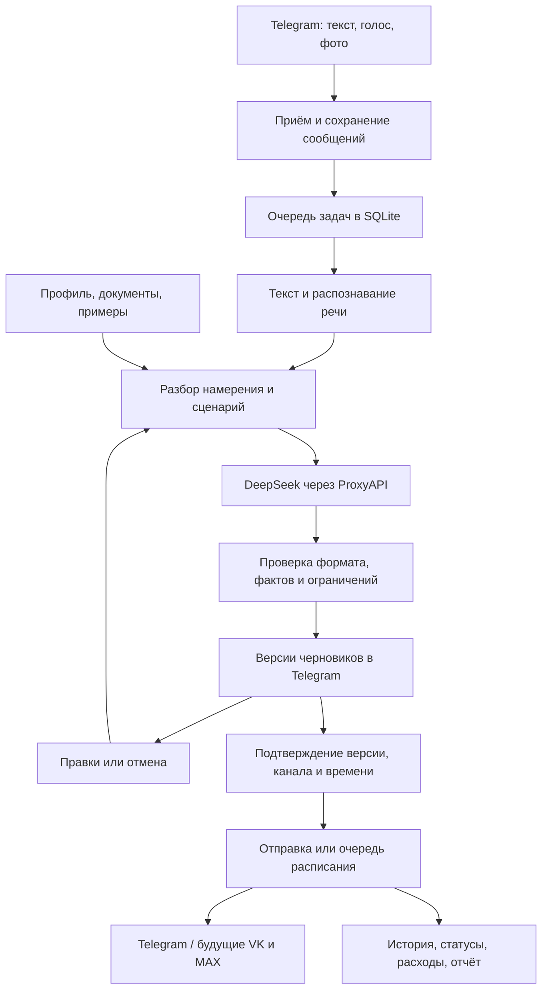

# MarketPilot: сценарий и архитектура после разговора с заказчиком

Статус: проект решения, а не описание уже реализованных функций.

Обновление реализации: в простом Telegram-боте добавлены пять вопросов, свободные текстовые задачи, уточнение фактов, AI-правки, отмена/восстановление, финальный предпросмотр с подтверждением, голосовой адаптер и сохраняемая очередь по пользователям. Актуальное описание интерфейса и ограничений — [TELEGRAM.md](TELEGRAM.md). Голос и новые AI-сценарии проверены локальными тестами с подменой API; проверка этих новых функций реальными запросами пока не выполнена. Остальные разделы ниже описывают целевой продукт.

Источник: предоставленная расшифровка разговора с заказчиком. В ней смешаны кейсы SMM и VR, есть ошибки распознавания. Требования ниже относятся к SMM. Примерный темп «один, максимум два поста в день» следует подтвердить; не считать его жёстким требованием.

## 1. Что заказчик хочет получить

| Смысл из разговора | Решение в продукте |
|---|---|
| Меньше времени на постановку задачи, контроль и правки | Запрос обычным языком, сохранённый профиль, адресные правки |
| Интервью или материалы мероприятия → готовый контент | Голос, текст и фото прикрепляются к одной задаче |
| Начать с внутренних новостей | Первый сценарий: Telegram-канал для сотрудников |
| Учитывать культуру, ценности и запрещённые выражения | Профиль бренда, ограничения и примеры хороших публикаций |
| Изображения не должны выглядеть шаблонной AI-генерацией | Приоритет настоящим фото, оформление по шаблону бренда |
| Следить за стоимостью | Лимиты, учёт вызовов, повторное использование извлечённых материалов |
| Выбрать одну законченную полезную функцию | Материалы → два поста → правка → подтверждение → канал |

Главная метрика — время человека до согласованного поста и количество правок. Продажи и охваты не являются единственной мерой успеха для внутренних коммуникаций.

## 2. Знакомство: пять коротких вопросов

Каждый вопрос — отдельное сообщение. Ответ можно написать, позднее — надиктовать. Ссылки, документы и образцы необязательны; их можно добавить после первого запуска.

1. **Что за компания?** Название, чем занимается. В том же сообщении можно отправить сайт.
2. **Для кого пишем?** Сотрудники, клиенты или партнёры. Для разных аудиторий сохранять отдельные настройки.
3. **Что хотите упростить?** Темы, написание, регулярность, обработка интервью или другое. Какой результат нужен?
4. **Как звучит компания?** Дружелюбно / делово / с юмором / свой вариант. Предложить прислать 2–3 удачных поста.
5. **Что обязательно учитывать?** Ценности, названия, запрещённые слова, факты, которые нельзя выдумывать. Брендбук можно приложить позже.

Бот показывает короткое резюме: компания, аудитория, задача, стиль, ограничения. Кнопки: «Всё верно», «Исправить». Никакой обязательной длинной формы или ручного составления промпта.

Подключение канала — отдельный пункт настроек. До подключения можно готовить и редактировать черновики. После подключения фиксируется конкретный канал, а не только название площадки.

Сайт нельзя считать изученным после одного сохранения ссылки: показать статус «ссылка сохранена» или «содержимое изучено» в зависимости от фактически выполненной обработки.

## 3. Основной диалог

**Пользователь, голосом:** «Сделай два поста про волейбольный турнир: анонс и напоминание. Для сотрудников, без официоза».

1. Бот скачивает голосовое, распознаёт речь и сохраняет расшифровку в задаче. В интерфейсе есть «Показать расшифровку», чтобы исправить дату, фамилию или название.
2. Извлекает количество, тему, аудиторию, виды постов и пожелания. Настройки стиля берёт из профиля.
3. Если нет даты и места турнира, задаёт один собранный вопрос: «Когда и где турнир? Как сотрудникам записаться?» Если этих сведений нет в задаче, сначала ищет их в приложенных материалах. Не выдумывает.
4. Если пользователь хочет приложить фото или текст, задача остаётся открыта для материалов до кнопки «Материалы готовы». Это отличает входные данные от нового поручения.
5. Без лишнего подтверждения создаёт два черновика, если запрос однозначен. Сложный план с датами сначала показывает на проверку.
6. Каждый пост приходит отдельной карточкой: текст, изображение при наличии, назначение и выбранный канал.

Кнопки под карточкой:

- **Изменить** — «Напишите, что исправить, или пришлите новый текст целиком».
- **Отменить пост** — отменяет конкретный черновик, не остальные посты задачи.
- **Отправить** — открывает финальный предпросмотр с названием канала и временем.

В финальном предпросмотре: **«Подтвердить отправку»** и **«Назад»**. Нажатие подтверждения и есть согласование конкретной версии; ещё одна обязательная кнопка «Согласовать» в этом сценарии не нужна.

Успешная отправка: ссылка на публикацию, если доступна, или внешний ID. При неопределённом результате — просьба проверить канал; повторять отправку автоматически нельзя.

## 4. Как работают правки

После «Изменить» бот привязывает следующее сообщение к post_id и версии. Принимает текст и голос:

«Сократи вдвое», «замени обращение на вы», «второй абзац слишком официальный».

В запрос на редактирование уходят профиль, исходные факты, текущий текст и конкретное пожелание. Другие посты не перегенерируются. Версия увеличивается, старые подтверждения теряют силу. Пользователь видит новый текст перед отправкой.

Можно вернуть предыдущую версию. Непонятную правку уточнить, а не выбирать произвольный пост. Нажатие кнопки конкретной карточки снимает большую часть неоднозначностей.

«Отмена» во время редактирования отменяет правку и сохраняет черновик. «Отменить пост» меняет состояние поста на отменённый. «Отменить задачу» отменяет всю оставшуюся работу, но не удаляет уже вышедшие публикации.

## 5. Архитектура: одно локальное приложение

Все блоки — модули одного приложения на компьютере команды. Развёртывание набора микросервисов не требуется. SQLite и каталог файлов — локально; AI, распознавание и публикация используют интернет.

### Границы модулей

| Модуль | Ответственность |
|---|---|
| Telegram | Сообщения, файлы, кнопки и предпросмотры |
| Сценарии | Анкета, уточнения, текущая задача и контекст правок |
| AI-клиент | Настраиваемые провайдер, адрес, модель, тайм-ауты |
| Распознавание | Голос → текст; отдельный провайдер, проверяемый до подключения |
| Материалы | Исходный текст, документы, фото и ссылки на источники |
| Генерация | Задача + профиль + выбранные источники → структурированные посты |
| Проверки | Формат, длина, обязательные сведения, запрещённые выражения; спорные факты помечаются |
| Публикация | Проверка прав, действующего согласования и выбранного канала |
| Фоновая работа | Выполнение сохранённых заданий и согласованного расписания |
| Отчёты | Реальные события публикации, доступные метрики и стоимость |

AI не получает произвольный доступ к отправке сообщений. Он предлагает тексты и структуру задачи; право публикации проверяет обычный код. Требования из документов рассматриваются как материалы бизнеса, а не как команды программе.

Распознавание речи — отдельная возможность, не следствие подключения текстового DeepSeek. В документации ProxyAPI есть раздел распознавания речи; доступную модель, работу с Telegram-аудио и стоимость проверяем отдельно. При ошибке распознавания предложить текстовый ввод, не терять задачу.

## 6. Какие данные храним

| Сущность | Содержание |
|---|---|
| Business | Компания, аудитории, цели, стиль, ограничения, версия профиля |
| Membership | Telegram user_id, business_id и роль: создание, согласование, публикация |
| Channel | business_id, площадка, внешний ID, отображаемое имя |
| Source | Файл или URL, извлечённый текст, дата, происхождение |
| Task | Автор, поручение, расшифровка, параметры, статус, ошибка |
| TaskSource | Какие материалы относятся к конкретной задаче |
| PostVersion | Текст, изображения, источники, номер версии, пост и задача |
| Approval | Пользователь, версия, канал, время, отметка подтверждения |
| Publication | Согласование, состояние отправки, внешний ID, время |
| Job | Тип работы, сохранённые входные данные, состояние, попытки |
| Usage / Event | Модель, токены, стоимость при наличии данных; журнал действий |

Два разрешённых Telegram ID сами по себе не означают общую компанию. Для демонстрации явно привязать обоих к одному тестовому Business, если это одна команда. Для разных клиентов изолировать профили, посты и каналы. Текущий простой бот хранит материалы отдельно по пользователям; общая работа потребует этой доработки.

При смене бизнес-профиля существующие задачи сохраняют снимок использованных настроек; новые используют актуальный профиль.

## 7. Состояния и защита от дублей

Задача: новая → ждёт материалы/уточнение → в очереди → выполняется → черновики готовы; отдельно ошибка и отмена.

Публикация: черновик → подтверждена конкретная версия → запланирована/отправляется → опубликована. Отдельные исходы: отменена, явная ошибка, доставка неизвестна.

- Правка текста, изображения, канала или времени аннулирует прежнее подтверждение.
- Повторный клик не создаёт новую публикацию. Подтверждение содержит post_id и revision.
- Одобрение одного поста не одобряет остальные.
- Фоновый обработчик отправляет только зафиксированную согласованную версию.
- При отмене фоновой генерации результат не возвращается как действующий черновик, даже если внешний вызов уже нельзя остановить.
- Входящее событие Telegram сначала записывается в устойчивую очередь с уникальным update_id. Только затем продвигается offset. Нельзя подтверждать событие до сохранения задачи: при сбое оно потеряется.
- Генерация выполняется вне цикла приёма сообщений. Иначе один длинный ответ блокирует обоих пользователей.
- Для отправки заранее сохраняется состояние «отправляется». После тайм-аута оно становится «доставка неизвестна», а не автоматически возвращается в очередь.

## 8. Как обеспечить качество и стоимость

Первый источник для новостей — предоставленные факты и настоящие фото. Для конкретных сотрудников и событий не подменять фотографии вымышленными сценами.

Сначала использовать реальные фото и брендовые шаблоны: логотип, цвета и подписи накладываются обычным кодом. Генерацию изображений добавить для иллюстраций, где вымысел допустим. Изображение входит в предпросмотр и согласуется вместе с текстом.

Для профиля достаточно нескольких хороших публикаций и правил бренда; не нужно отправлять всю историю чата и все документы с каждым запросом. Извлечённые сведения хранить и использовать повторно. На первых документах достаточно простого поиска по разделам; отдельная векторная база не обязательна.

Разбор понятного короткого поручения и генерацию можно объединять в один структурированный вызов. При неоднозначной задаче сначала извлечь параметры и уточнить их. Не добавлять несколько независимых AI-редакторов на каждый пост без измеримой пользы.

Обычный код проверяет заполнение полей и технические ограничения. AI-проверка может находить неподтверждённые утверждения, но не является гарантией истинности. Числа, даты и фамилии показывать вместе с источником или вопросом, если есть сомнения.

На бизнес задать предел постов в задаче, расходов в день и попыток исправления невалидного ответа. Перед большим пакетом спросить подтверждение объёма. Стоимость считать по данным провайдера; если точной суммы нет, показывать токены и обозначенную оценку, а не выдуманные рубли.

## 9. Автономная работа

Сначала пользователь выбирает темы, частоту и время в часовом поясе компании. AI по расписанию готовит новые черновики и напоминает о согласовании. Заранее согласованные версии публикуются в назначенное время, пока локальное приложение работает.

Новые материалы без подтверждения не отправляются. Если согласования нет, дата прошла или программа была выключена — показать пропуск и предложить новое время, не публиковать молча задним числом. Не обещать постоянную автономность при выключенном компьютере: для этого позже нужен постоянно работающий хост.

## 10. Приоритет разработки на хакатоне

1. Свободный текст: «нужно два поста о ...». Количество и тема должны реально влиять на результат, вместо текущих фиксированных трёх постов по общему брифу.
2. Правки по пожеланию и кнопки отмены. Отдельный финальный предпросмотр с подтверждением отправки.
3. Голос: скачивание → распознавание → тот же текстовый сценарий. Отдельно проверить имена и даты.
4. Исходные материалы: сначала текст и фото, затем один формат документов. Один комплект материалов привязывается к одной задаче.
5. Примеры стиля и правила бренда. Провести сравнение на материалах заказчика.
6. План на неделю и публикация согласованных версий по времени.
7. Простой отчёт и учёт вызовов. Вторую площадку подключать после устойчивого первого сценария.

Mini App и обработка/монтаж видео не входят в первый показ. Переход на другое приложение не должен быть условием работы в Telegram.

## 11. Демонстрация и измерение результата

Подготовить реальный или явно тестовый инфоповод, подтверждённые факты, фото и несколько образцов стиля.

Сценарий на 3 минуты: короткое знакомство → голос «два поста» → уточнение недостающих фактов → два черновика → «во втором сократи вступление» → отменить один → отправить другой в тестовый канал → показать результат и историю.

Для оценки взять 3–5 одинаковых инфоповодов и сравнить ручной процесс с ботом. Измерить время работы человека, время до первого черновика, число правок, долю постов, принятых без смысловых исправлений, число ошибок в фактах и стоимость согласованного поста. Экономию времени объявлять только после такого измерения. Примеры критериев качества: соответствие источникам, понятность, тон, отсутствие канцелярита и уместность для сотрудников.

## 12. Что уже работает, а что проектируем

В текущем telegram_bot.py: девять вопросов, сохранение по Telegram ID, DeepSeek через ProxyAPI, фиксированный пакет из трёх постов, ручная замена текста, согласование и Telegram-публикация. Доступны два разрешённых пользователя.

Предлагаемая пятишаговая анкета, произвольные задания, распознавание голоса, AI-правки, материалы, общая компания, устойчивая очередь, изображения, планировщик и отчёты — следующие изменения. Сам факт составления архитектуры не означает, что эти функции реализованы.

Материалы для подготовки интеграций: [ProxyAPI](https://proxyapi.ru/docs). Параметры распознавания речи и генерации изображений необходимо проверить на конкретных доступных моделях перед реализацией.
